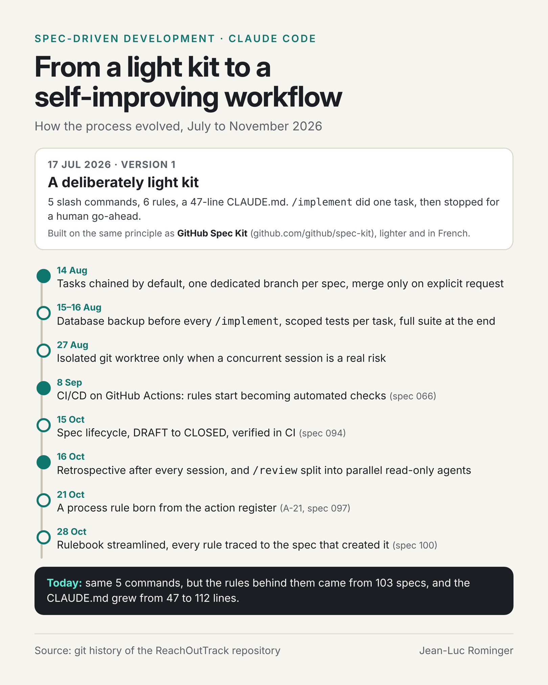

# Changelog

This kit is extracted from the workflow used on a real production project between July and November 2026. The dates below are those of that project.

## 1.1.1 — 2026-11
### Changed
- Workflow visual (`docs/images/workflow.png`) shows the optional `/brainstorm` step: a dashed step 0 before `/specify`, and an optional human gate (specify, postpone or drop). The three mandatory human gates stay unchanged.

### Added
- Editable source of the workflow visual, with render instructions: `docs/images/src/`.

## 1.1.0 — 2026-11
### Added
- `/brainstorm`: optional framing step before `/specify`, for topics that are still unclear. Entry test, one-question-at-a-time interview, current state backed by file:line evidence, two or three options including "do nothing", mandatory outcome (framing note, postpone or drop). No code, no spec, no branch.

### Changed
- `/specify` starts from an existing framing note and asks only its open questions.

### How the workflow got there
- **2026-11-14** — Optional framing step before `/specify`, after several specs were reworked because of unverified claims about existing behaviour.

## 1.0.0 — 2026-11 (first public version, MIT licence)
Generic, English version of the workflow as of November 2026.

### How the workflow got there

- **2026-07-17** — Initial light kit: 5 slash commands, 6 rules. `/implement` did one task, then stopped for a go-ahead. Built on the same principle as GitHub Spec Kit, lighter.
- **2026-08-14** — Tasks chained by default; one dedicated branch per spec; pull request and merge only on explicit request.
- **2026-08-15 / 16** — Database backup before every `/implement` (T-00); scoped tests per task, full suite at the end of the spec.
- **2026-08-27** — Isolated git worktree only when a concurrent session is a real risk.
- **2026-09-08** — CI/CD: project rules start becoming automated checks.
- **2026-10-15** — Spec lifecycle statuses, verified in CI.
- **2026-10-16** — Retrospective after every session (self-critique and rapport d'étonnement); `/review` split into parallel read-only sub-agents.
- **2026-10-28** — Rulebook streamlined; every rule traced to the spec that created it.
