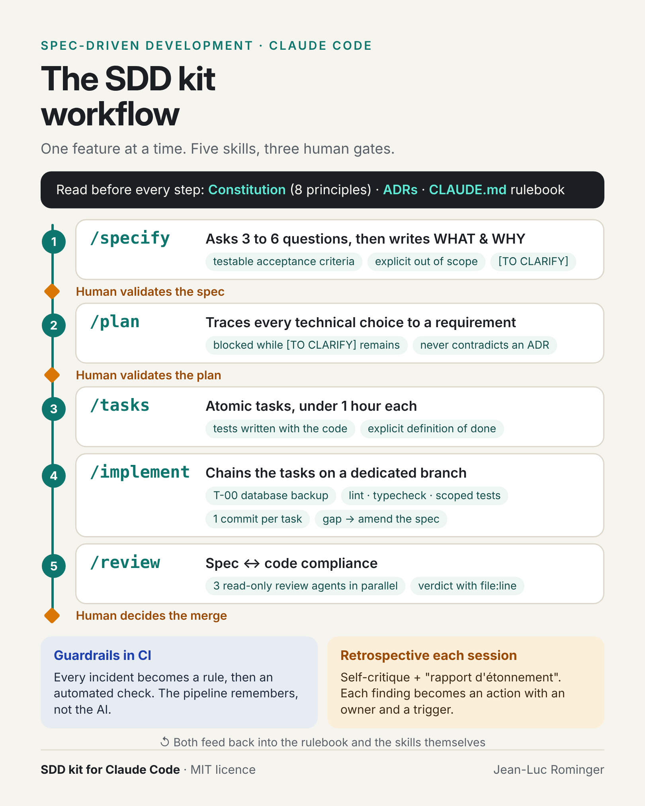

# SDD kit for Claude Code

A Spec-Driven Development (SDD) workflow for building software with Claude Code: five slash commands plus an optional framing step, a constitution, a spec template and a continuous-improvement ritual.

It comes from a real project: a production web app built in about 100 days, with over 100 specs, roughly one line of specification per line of code, and around 6,000 automated tests. This kit is the process, stripped of anything project-specific.

## The cycle



```
(/brainstorm, optional) -> /specify -> human validation -> /plan -> human validation -> /tasks -> /implement -> /review
```

| Step | What Claude does | What the human does |
|---|---|---|
| `/brainstorm` (optional) | Frames a still-unclear topic: questions one at a time, current state backed by evidence, two or three options including "do nothing". Writes no code and no spec. | Chooses: specify, postpone or drop. |
| `/specify` | Asks 3 to 6 questions, then writes WHAT and WHY only, with testable acceptance criteria. Unclear points stay `[TO CLARIFY]`. | Answers, then approves the spec. |
| `/plan` | Re-reads the constitution and ADRs, writes the technical plan, traces each choice to a requirement. Refuses to start while `[TO CLARIFY]` remains. | Approves the plan. |
| `/tasks` | Splits the plan into tasks under 1 hour, each testable, tests written with the code. | Approves the list. |
| `/implement` | Chains the tasks: tests green, box ticked, one commit per task. Stops and proposes a spec amendment on any gap. | Steps in only on a gap. |
| `/review` | Compares spec and code, checks each project convention, optionally with parallel read-only review agents. | Decides whether to merge. |

## What makes it work

1. **The spec asks before it writes.** Questions first, then a spec with no technical decision in it.
2. **A constitution above every decision.** A short list of non-negotiable principles, re-read before every plan.
3. **Small steps, no improvisation.** When the code reveals a gap, the spec is amended, not patched around.
4. **Every incident becomes a rule, then a guardrail.** Write it in CLAUDE.md with the spec that triggered it, then turn it into an automated check in the CI.
5. **A retrospective after every session.** Self-critique plus a "rapport d'étonnement" (what surprised the agent), each finding becoming an action with an owner and a trigger.

## What's in the kit

```
CLAUDE.md                          # rulebook read by the agent at every session: fill in the <placeholders>
.claude/commands/                  # the five slash commands /specify /plan /tasks /implement /review, plus the optional /brainstorm
.claude/agents/review-axis.md      # read-only reviewer used by /review in parallel mode
.claude-plugin/                    # plugin manifest, marketplace file and icon: the repository installs as a Claude Code plugin
plugin/commands/init.md            # /sdd-kit:init, plugin only: adds the rulebook, docs and templates to a project
agents/review-axis.md              # the plugin's copy of the reviewer, kept identical by CI
.claude/settings.example.json      # safe default permissions (rename to settings.json)
docs/GUIDE.md                      # full user guide: setup, daily use, why each rule exists, FAQ
docs/constitution.md               # non-negotiable principles
docs/architecture-decisions.md     # ADR template
docs/continuous-improvement.md     # retrospective method, action register, journal template
specs/000-template/                # spec.md, plan.md and tasks.md templates
examples/001-csv-export/           # a complete worked example: spec, plan, tasks
docs/images/                       # the workflow and evolution visuals, and the repository's social preview
docs/images/src/                   # editable sources of the visuals, with render instructions
CHANGELOG.md                       # how the workflow evolved
MAINTAINING.md                     # how the kit is kept in sync with its source project
CONTRIBUTING.md                    # how to contribute: experience reports, ports, rule proposals
.github/                           # issue forms, pull request template, Kit checks workflow
LICENSE                            # MIT
```

## Quick start

### As a Claude Code plugin (recommended)

In Claude Code:

```
/plugin install sdd-kit --marketplace BretzelCoder/sdd-kit
```

This one-step form needs Claude Code 2.1.275 or later. On an older version, run `/plugin marketplace add BretzelCoder/sdd-kit`, then `/plugin install sdd-kit@bretzelcoder`.

Then, in your project:

1. Run `/sdd-kit:init`. It copies `CLAUDE.md`, the constitution, the ADR and continuous-improvement documents and the spec templates into your project, without overwriting anything.
2. Fill in the `<placeholders>` in `CLAUDE.md`.
3. Run `/sdd-kit:specify <your first feature>`.

With the plugin, every command has the `sdd-kit:` prefix: `/sdd-kit:plan`, `/sdd-kit:implement`, and so on. The plugin updates with each kit release.

### By copying the files

1. Copy the kit into the root of your repository.
2. Rename `.claude/settings.example.json` to `.claude/settings.json`.
3. Fill in the `<placeholders>` in `CLAUDE.md`.
4. Run `/specify <your first feature>` in Claude Code.

Step-by-step instructions are in [docs/GUIDE.md](docs/GUIDE.md). For the expected level of detail, read [the worked example](examples/001-csv-export/spec.md).

Using another coding agent? The method is tool-agnostic: see section 7 of the guide.

## Adapt it

- Start light. The rules in a mature CLAUDE.md come from incidents; let yours grow the same way.
- Keep the two human validations. They are what keeps speed from turning into drift.
- Reduce the human-in-the-loop only as fast as your automated checks allow.

## Contributing

Used the kit on a project? An [experience report](https://github.com/BretzelCoder/sdd-kit/issues/new/choose) is the most useful contribution: every rule in the kit came from an incident, and yours are how the next ones get found. Ports to other agents and rule proposals are welcome too. See [CONTRIBUTING.md](CONTRIBUTING.md), and ask questions in [Discussions](https://github.com/BretzelCoder/sdd-kit/discussions).

## Maintenance

The kit is kept in sync with the project it comes from. See [MAINTAINING.md](MAINTAINING.md) for how changes are detected, filtered and released.

## Licence

[MIT](LICENSE). You can use, adapt and redistribute the kit, including commercially. If you reuse it, keeping the copyright notice and a link back to this repository is appreciated.

## Author

Jean-Luc Rominger. Feedback and improvements are welcome through issues and pull requests.
